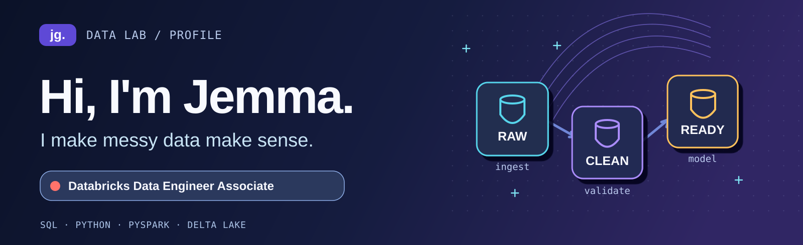
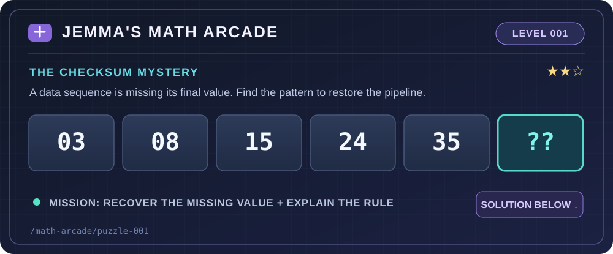
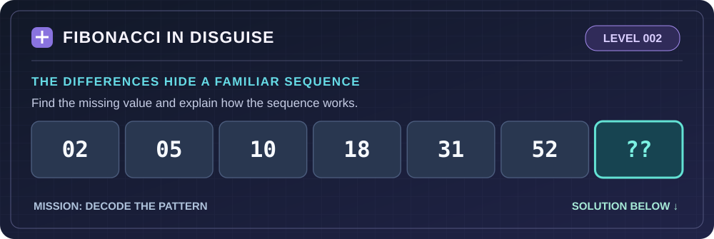
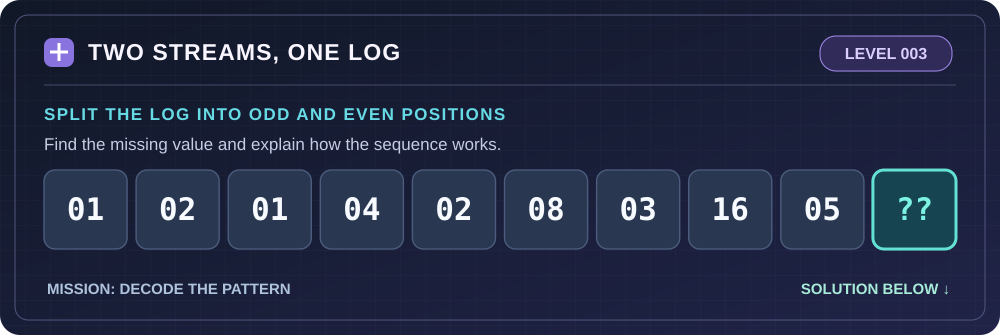
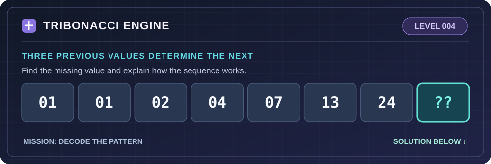
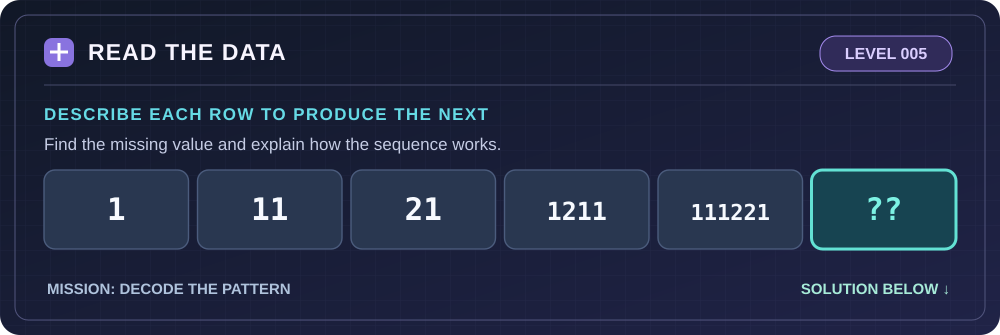
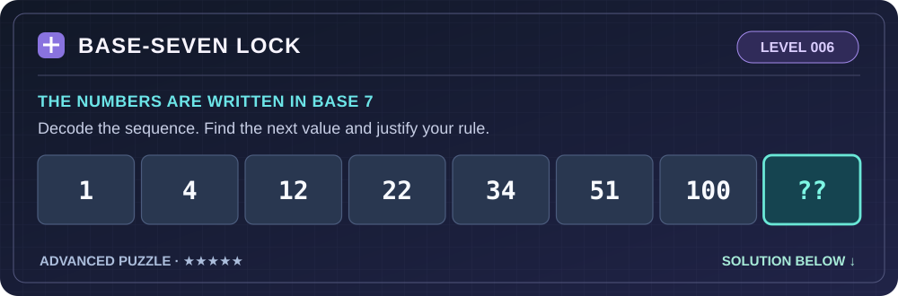
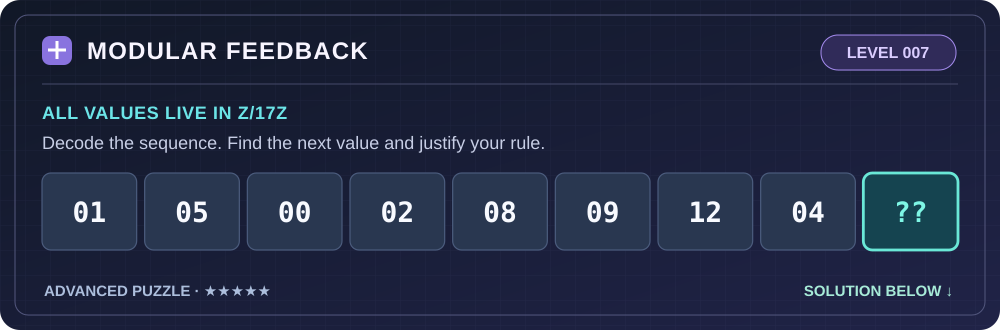
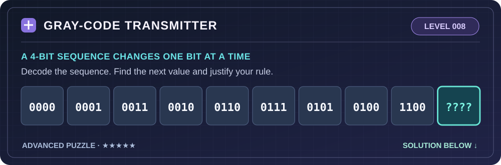

<div align="center">



<br>

**Mathematics educator → Aspiring Data Engineer**  
*Curious about why data breaks, how pipelines work, and what makes analytics trustworthy.*


</div>

---

### 💻 `~/jemma` — a quick introduction

```text
$ whoami
  Jemma — aspiring Data Engineer, math educator, lifelong learner

$ current_mission
  Build pipelines that don't just run — they can be trusted.

$ favorite_questions
  Where did this row come from? Why is it missing? What could break?
```

<table>
<tr>
<td width="50%" valign="top">
<h3>🛠️ At my workbench</h3>
<ul>
<li><strong>Languages:</strong> SQL, Python, PySpark</li>
<li><strong>Platform:</strong> Databricks, Apache Spark, Delta Lake</li>
<li><strong>Patterns:</strong> ETL/ELT, medallion architecture, dimensional modeling</li>
<li><strong>Dev workflow:</strong> Git, GitHub, VS Code</li>
</ul>
</td>
<td width="50%" valign="top">
<h3>🧪 What I'm experimenting with</h3>
<ul>
<li>Systematic data quality checks</li>
<li>CI/CD and production-friendly Databricks workflows</li>
<li>Incremental ingestion and reliable transformations</li>
<li>Math, simulation &amp; data science side quests</li>
</ul>
</td>
</tr>
</table>

### 🗂️ Featured experiments

<table>
<tr>
<td width="50%" valign="top">
<p><strong>🚕 <a href="https://github.com/jg0901/NYC-Mobility-Data-Pipeline">NYC Mobility Pipeline</a></strong></p>
<p>Taxi data ingestion, transformations, quality checks, and analytical modeling.</p>
<code>Databricks</code> · <code>SQL</code> · <code>Data Quality</code>
</td>
<td width="50%" valign="top">
<p><strong>🛒 <a href="https://github.com/jg0901/Week6-Instacart-Pipeline">Instacart Pipeline</a></strong></p>
<p>Incremental ingestion, validation gates, and medallion processing.</p>
<code>Lakeflow</code> · <code>Auto Loader</code> · <code>PySpark</code>
</td>
</tr>
<tr>
<td width="50%" valign="top">
<p><strong>🎵 <a href="https://github.com/jg0901/Week5-Chinook-Dimensional-Model">Chinook Dimensional Model</a></strong></p>
<p>From normalized source tables to a star schema and business-ready views.</p>
<code>SQL</code> · <code>Star Schema</code> · <code>Analytics</code>
</td>
<td width="50%" valign="top">
<p><strong>🛍️ <a href="https://github.com/jg0901/Week4-Retail-Loyalty-Purchasing-Behavior-Pipeline">Retail Loyalty Pipeline</a></strong></p>
<p>Bronze–Silver–Gold pipeline with warning flags and quality controls.</p>
<code>Lakeflow</code> · <code>Delta Lake</code> · <code>Validation</code>
</td>
</tr>
</table>

### 🌱 Lab activity — small steps, real progress

Not every learning session becomes a commit, but here's where my experiments take shape.

| 🧪 Current lab quests | What I'm practicing |
|:--|:--|
| 🔧 **Pipeline reliability** | Data checks, testing and simpler workflows |
| 🚀 **Ship with confidence** | Git, CI/CD and deployment patterns |
| 🧠 **Math side quests** | Probability, simulation and problem solving |

**The green squares:** GitHub's live contribution calendar is just below this profile README. It reflects qualifying GitHub activity, not every hour of learning.

### 🎮 Math Arcade

<div align="center">
  
</div>

<details>
<summary><strong>🔓 Unlock the answer — Puzzle #001</strong></summary>

**Answer: 48.** The differences are `5, 7, 9, 11, 13`, so the next number is `35 + 13 = 48`.

For day `n = 1, 2, 3, …`, the rule is `n * (n + 2)`.

```sql
SELECT day_number, day_number * (day_number + 2) AS puzzle_value
FROM days;
```

**Data quality footnote:** This is a number-pattern puzzle, not a production checksum. Actual checksums depend on record contents and require a defined validation method.

</details>

<div align="center">
  
</div>

<details>
<summary><strong>🔓 Reveal solution — Level 002</strong></summary>

**Answer: 86.** The differences are **3, 5, 8, 13, 21**: consecutive Fibonacci numbers. The next difference is **34**. Therefore `52 + 34 = 86`.

*Pattern tip:* Look for a pattern in successive differences.

</details>

<div align="center">
  
</div>

<details>
<summary><strong>🔓 Reveal solution — Level 003</strong></summary>

**Answer: 32.** Split by position. Odd positions: **1, 1, 2, 3, 5** (Fibonacci). Even positions: **2, 4, 8, 16, 32** (powers of two). Position 10 is even, so the answer is **32**.

*Pattern tip:* Two interleaved series can disguise simple rules.

</details>

<div align="center">
  
</div>

<details>
<summary><strong>🔓 Reveal solution — Level 004</strong></summary>

**Answer: 44.** Each term is the sum of the previous **three** terms: `1 + 1 + 2 = 4`, `1 + 2 + 4 = 7`, and so on. The next is `7 + 13 + 24 = 44`.

*Pattern tip:* A third-order recurrence instead of the usual Fibonacci recurrence.

</details>

<div align="center">
  
</div>

<details>
<summary><strong>🔓 Reveal solution — Level 005</strong></summary>

**Answer: 312211.** The **look-and-say sequence** describes consecutive groups of digits. `111221` is *three 1s, two 2s, one 1*, producing **312211**.

*Pattern tip:* Some number puzzles are really about strings, not arithmetic.

</details>

<div align="center">
  
</div>

<details>
<summary><strong>🔓 Reveal solution — Level 006</strong></summary>

**Answer: 121₇.** Treat the sequence as numbers written in **base 7**. Their decimal values are `1, 4, 9, 16, 25, 36, 49` — perfect squares. Next is `64₁₀ = 121₇`.

*Why this works:* In base 7, `121` means `1×7² + 2×7 + 1 = 64`.

</details>

<div align="center">
  
</div>

<details>
<summary><strong>🔓 Reveal solution — Level 007</strong></summary>

**Answer: 14.** A fitting recurrence is **aₙ₊₁ ≡ 3aₙ + 2 (mod 17)**. For example, after 5 comes `(3×5+2) mod 17 = 0`. After 4 comes **`(3×4+2) mod 17 = 14`**.

*Why this works:* The modulo operation wraps values back into the set 0–16.

</details>

<div align="center">
  
</div>

<details>
<summary><strong>🔓 Reveal solution — Level 008</strong></summary>

**Answer: 1101.** This is the 4-bit **binary-reflected Gray code** sequence. Each neighboring code differs in exactly one bit. For decimal `n`, Gray code is `n XOR (n >> 1)`. At `n = 9`: `1001 XOR 0100 = 1101`.

*Why this works:* An example of bitwise reasoning, useful in digital systems and coding theory.

</details>

<sub>🧪 Eight puzzles and counting. Pattern puzzles may admit more than one valid rule; each solution specifies an intended rule.</sub>

### 🪄 A little more about me

<details>
<summary><b>📐 Why a math educator ended up building data pipelines</b></summary>
<br>
I started in mathematics and teaching, where I learned to ask *why* a solution works — not just whether it produces an answer. Data engineering scratches the same itch: testing assumptions, tracing issues to their source, and building systems that hold up under scrutiny.
</details>

<details>
<summary><b>🔭 What's next in the lab?</b></summary>
<br>
I'm developing my skills in production-oriented data engineering, particularly CI/CD, ingestion patterns, testing, and maintainability. I'm also exploring small, curiosity-driven math and data science experiments along the way.
</details>

---

<div align="center">

**`SELECT curiosity, consistency, growth FROM my_journey;`**

<sub>Made with ☕, SQL, and a suspicious number of data quality checks.</sub>

</div>
